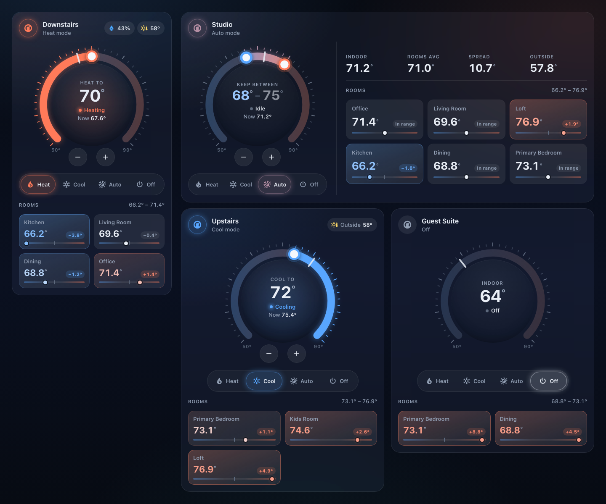

# Glasshouse Climate Card

A dial thermostat for Home Assistant, one card per HVAC zone, with the zone's rooms arranged beside
it. Part of the **Glasshouse** suite: refined dark glass, one accent per device type, live numbers.
It replaces the stock thermostat card with something that looks at home on a Glasshouse dashboard.



## Features

- **Dial**: a 270° arc with a soft cool-to-warm gradient track, tick marks and end labels from the
  entity's `min_temp` / `max_temp`. The setpoint is a draggable thumb (pointer events, works with touch,
  mouse and pen); drag anywhere on the ring to move it. The current temperature is a small mark on the
  arc.
- **Centre readout**: the setpoint in large type, with the hvac action (`Heating`, `Cooling`, `Idle`, …)
  and the current temperature below it.
- **Heat/cool (`heat_cool`)**: two thumbs for `target_temp_low` / `target_temp_high`, kept at least 2 °F
  (1 °C) apart. Tap either number in the centre to pick which one the − / + buttons move.
- **− / + buttons** in the gap at the bottom of the dial.
- **Snapping** to the entity's `target_temp_step` (or 1 °F / 0.5 °C when it has none).
- **Debounced service calls**: the dial updates instantly while you drag or tap, and
  `climate.set_temperature` is called once, 800 ms after the last change. The new target stays on
  screen until the thermostat reports it, so the number never jumps back.
- **Accent follows the mode and action**: heat is warm (`--gh-heat`), cool is cool (`--gh-cool`), heat/cool
  uses a gradient, off is neutral. While the system is actively heating or cooling, a soft glow breathes
  behind the dial (static when reduced motion is on).
- **Mode control**: a segmented pill with icons for each of the entity's `hvac_modes`
  (`climate.set_hvac_mode`).
- **Fan modes** (optional): chips for the entity's `fan_modes` (`climate.set_fan_mode`).
- **Rooms**: a chip per room sensor, tinted on a cool-to-warm scale relative to the setpoint, with a small
  delta (`+1.4°`) and a mini scale bar. In heat/cool the delta is measured to the nearer edge of the band
  and rooms inside it read **In range**. When the system is off, rooms are compared with the zone's own
  temperature.
- **Layout**: on a wide card the dial sits on the left and the rooms on the right, under a strip of
  zone stats (indoor, rooms average, spread, outside, humidity). On a narrow card everything stacks.
- **Header** with zone name, mode and preset, plus humidity and outside-temperature chips.
- **Unavailable** thermostats are dimmed with a badge, and no controls send anything.
- Sections view ready (`columns: 12`, `min_columns: 6`, `rows: auto`), phone width (360 px) up to wide
  desktop. Keyboard and screen-reader friendly (each thumb has a labelled range input). Respects
  `prefers-reduced-motion`.
- No dependencies, no build step: one JavaScript file.

## Installation

### HACS (custom repository)

1. HACS → ⋮ → **Custom repositories**.
2. Add `https://github.com/petergCA/glasshouse-climate-card` with type **Dashboard**.
3. Install **Glasshouse Climate Card**, then reload the browser.

### Manual

1. Copy `glasshouse-climate-card.js` to `config/www/`.
2. Settings → Dashboards → ⋮ → **Resources** → add `/local/glasshouse-climate-card.js` as a
   **JavaScript module**.

For the full look, pair it with the **Glasshouse** theme.

## Configuration

| Option | Type | Default | Description |
|---|---|---|---|
| `type` | string | **required** | `custom:glasshouse-climate-card` |
| `entity` | entity | **required** | The `climate.*` entity for the zone. |
| `name` | string | friendly name | Zone name in the header. |
| `icon` | string | `mdi:thermostat` | Header icon. |
| `humidity` | entity | – | Humidity sensor for the chip. Without it, the thermostat's `current_humidity` is used when present. |
| `outside` | entity | – | Outdoor temperature sensor, shown as "Outside 58°". |
| `show_dial` | boolean | `true` | `false` hides the dial, modes and fan: a read-only zone summary (stats + rooms), e.g. when an automation or integration owns the setpoint. |
| `target` | entity | – | A target-temperature sensor to compare rooms with instead of the thermostat's setpoint (e.g. a comfort controller's target). Also shown as a **Target** stat. |
| `feels_like` | entity | – | A feels-like sensor, shown first in the stats strip (the thermostat reading is then labelled **Thermostat**). |
| `rooms` | list | – | Room temperature sensors, as entity ids or `{entity, name}` objects. |
| `show_modes` | boolean | `true` | Show the hvac mode control. |
| `show_fan` | boolean | `false` | Show fan mode chips (when the entity has `fan_modes`). |
| `min_temp` / `max_temp` | number | entity's range | Dial range. Many thermostats report a very wide range (e.g. 32–122 °F); set e.g. `55` / `85` for a usable dial. Setpoints outside are still shown at the ends. |
| `min_gap` | number | `2` (°F) / `1` (°C) | Smallest gap kept between the two heat_cool setpoints (some thermostats need 3 °F). |
| `scale` | number | `2` (°F) / `1` (°C) | Degrees from the setpoint at which a room chip is fully cool or warm. Within a quarter of this a room is neutral. |

### Interaction

| Action | Result |
|---|---|
| Drag on the dial | Move the setpoint (the nearer thumb in heat/cool). |
| − / + | One step down / up. |
| Tap a centre number (heat/cool) | Choose which setpoint − / + move. |
| Arrow keys on a focused thumb | One step (the thumbs are range inputs for keyboards and screen readers). |
| Mode segment | `climate.set_hvac_mode`. |
| Fan chip | `climate.set_fan_mode`. |
| Header, chips, room chips | Open more-info for that entity. |

### Theming

Every design token can be overridden from a theme with a `glasshouse-*` variable, for example
`glasshouse-surface`, `glasshouse-radius`, `glasshouse-text-2`, `glasshouse-heat`, `glasshouse-cool`.

## Examples

Minimal:

```yaml
type: custom:glasshouse-climate-card
entity: climate.downstairs
```

Full:

```yaml
type: custom:glasshouse-climate-card
entity: climate.downstairs
name: Downstairs
humidity: sensor.downstairs_humidity
outside: sensor.outdoor_temperature
rooms:
  - entity: sensor.kitchen_temperature
    name: Kitchen
  - entity: sensor.living_room_temperature
    name: Living Room
  - sensor.office_temperature
show_modes: true
show_fan: true
```

Compact, no mode control:

```yaml
type: custom:glasshouse-climate-card
entity: climate.upstairs
show_modes: false
rooms:
  - sensor.bedroom_temperature
  - sensor.nursery_temperature
```

## Development

`test/harness.html` renders the card offline with stub `ha-card` / `ha-icon` elements and a mock
`hass` (`test/mock-hass.js`, generic demo data, climate entities that react to `set_temperature`,
`set_hvac_mode` and `set_fan_mode`). Open it in a browser; `?layout=phone`, `?layout=desktop` and
`?layout=preview` (the composition in `docs/preview.png`) show every state, and `&sim=<value>` drags the
first dial with real pointer events. `test/shot.sh` takes headless Chrome screenshots of it.
`test/interaction.test.cjs` covers dragging with the debounced call, step snapping, heat/cool thumbs,
mode and fan changes, the room colour scale, keyboard input, the unavailable state and diffing under
jsdom (`npm i jsdom` in a scratch directory, then run it from there with node).

## License

MIT © Peter Gray
